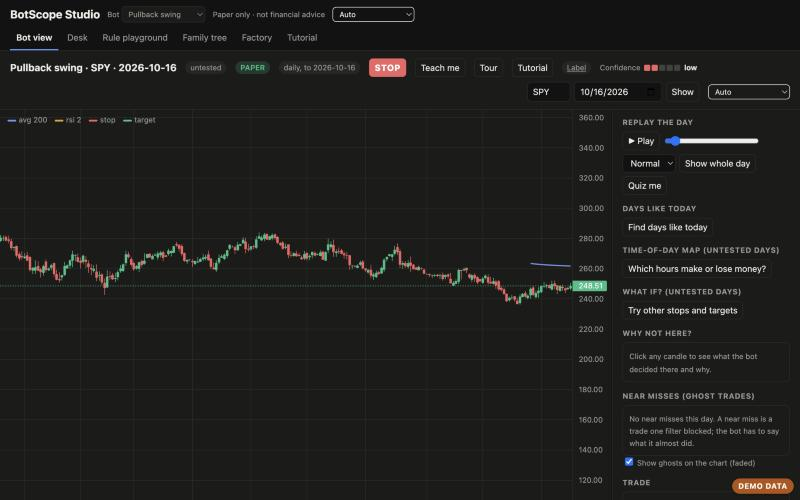
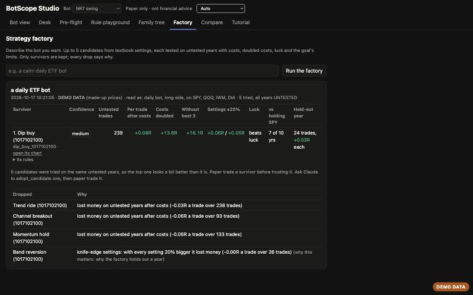
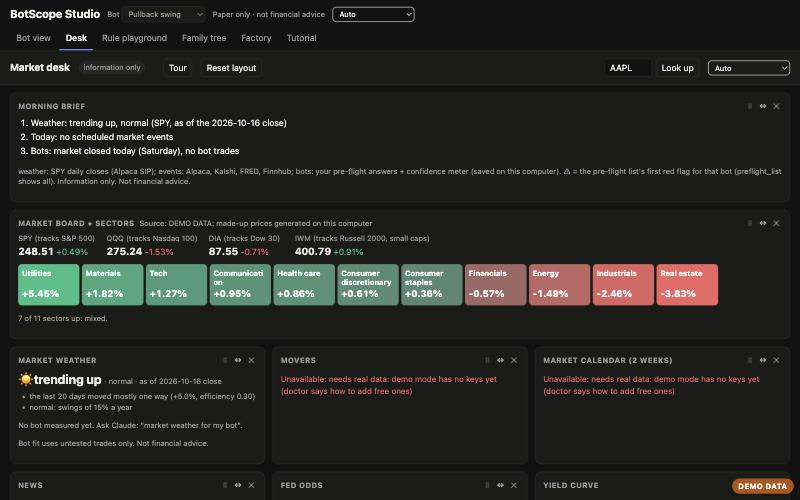

# BotScope

> BotScope gives you stock information for your own personal trading decisions. You can also use it with paper trading. It never places real orders for you and isn't financial advice.

**Look inside your own trading bots, from your own Claude.** Free for personal use.

BotScope is a toolkit you plug into Claude (an MCP server + a Claude Code plugin, about 90 tools). It shows what a
bot sees candle by candle, tests it honestly (tuned years vs untested years, real costs, a luck meter), and keeps
every order on paper unless you go through a strict graduation test. **Not financial advice.**



## Try it in 2 minutes (no keys, no account)
With no keys, BotScope runs in **demo mode**: made-up prices generated on your computer, with a **DEMO DATA** badge
on every page and every result. Nothing real, nothing to sign up for. Needs [uv](https://docs.astral.sh/uv/).
```bash
git clone <this repo> botscope && cd botscope
```
```bash
uv run botscope demo
```
That one command checks the setup, runs the strategy factory on "a calm daily ETF bot" and opens BotScope Studio.
It always uses made-up prices and keeps its results in their own folder (`data/demo/`), even if you have keys. Or
step by step:
```bash
uv run botscope doctor
```
```bash
uv run botscope strategy_factory "a calm daily ETF bot"
```
```bash
uv run botscope open_studio
```
`doctor` says "ready in DEMO mode" and how to switch to real data. The factory writes a few candidate bots, tests
each one honestly and shows which survived and why the others were dropped. `open_studio` prints a local link
(127.0.0.1 only) to BotScope Studio: the bot view, the market desk, the rule playground, the family tree, live signals from your own strategies, factory
results and a hands-on tutorial, in one page that also works at phone width.

Demo prices are a seeded random walk, not market data, so **demo results mean nothing about real markets**.

**Switch to real data:** get free Alpaca **paper** keys at alpaca.markets, copy `.env.example` to
`~/.botscope/.env`, fill in `ALPACA_API_KEY` and `ALPACA_SECRET_KEY`, and run `uv run botscope doctor` again.
Then connect it to Claude Code (see Setup below) and ask things like "honest report for pullback swing".

| Strategy factory | Market desk |
|---|---|
|  |  |

## The strategy factory
Describe the bot you want in one sentence ("a calm daily ETF bot", "a hands-off momentum bot on index ETFs", "an
intraday bot on SPY, long and short"). BotScope reads the goal back to you, writes up to 5 candidate bots from
textbook templates (settings never tuned on your data), and tests them one at a time. A candidate is dropped, with
the reason in plain words, if it:
- fails `check_bot` (peeks at the future, or its rules don't match its settings),
- has fewer than 30 trades, loses money after costs, loses with costs doubled, or needs its 3 best trades,
- lost money in most untested years, or only made money in the earlier half of them,
- breaks the goal's own limits ("calm": deepest drop and losing streak; "active" / "hands-off": trades a year),
- falls apart with every setting 20% smaller or bigger (knife-edge settings),
- looks like luck next to random twins.

Every one of those decisions leaves out the last year; survivors then show that **held-out year**. Survivors are
ranked by confidence level, never by profit alone, and the factory counts every candidate you've tried on the same
symbols (more tries = more chances for a lucky survivor). "No candidate survived" comes with the closest miss.
Open any candidate's chart before adopting it (`factory/<run>/<id>` works in every tool, or "open its chart" in
Studio); `adopt_candidate` copies one into your bots folder after a checkpoint.

**Research (Studio's Factory tab, "Research and test 5").** With the Claude panel switched on, the factory asks your
own Claude Code (headless `claude -p`, your login and plan) to look up 5 well-known, published strategies that fit
the goal (web search allowed) and write each as a bot file with plain-English rules, published settings and the
source of the idea, which the tab shows next to each candidate. Claude only gets web search and web fetch (no MCP
servers, so no broker tools), the live-order guard rides along, and its prompt goes on stdin. BotScope then reads
every file before running any of it and refuses anything a bot doesn't need: imports beyond a few math modules and
`botscope.bot`, files, network, processes, `eval` and friends, double-underscore tricks, anything that looks like an
order. A refused file is retried once and never saved as a loadable `.py`. If research can't run (no `claude`
command, not logged in, offline, the panel off), the run uses the textbook templates and says why. Research only
changes where the ideas come from: every candidate goes through the same tests above, and "N were tried" still counts.
The route needs what the Claude panel needs: this computer, the exact host and origin, and this launch's token.

## The promises
**Honest numbers**
- Every result says which numbers come from **tuned** days (where the settings were picked, so they look good) and
  which come from **untested** days (the real test), and names its data source.
- No success-rate percentages, no promises of profit, no projections without a range. A test fails the build if one
  sneaks in.
- Trading costs are always taken out, and every test also shows the result with costs doubled and without its
  3 best trades.
- Confidence is five levels (very low to very high) from trade counts and untested results, never a made-up %.
- "Nothing survived" and "looks like luck" are real answers, said plainly.

**Safe by default**
- Paper trading only. No BotScope tool places an order. Live money stays locked unless you turn it on in your own
  `.env`, the bot passes 8 paper checks, the order is under a size cap, and you say yes to that order.
- STOP blocks every order and turns every bot off. A runaway brake stops more than 20 orders a day.
- Your keys stay in your own `.env` on your computer and are never printed. Pages only answer on 127.0.0.1.
- BotScope never redistributes market data: you download it with your own keys, and it stays on your computer.

**Not financial advice.** BotScope never tells anyone what to buy, sells signals, or manages money. Past results,
even honest ones, don't predict the future.

## Highlights
| Tool | What it does |
|------|--------------|
| `doctor` | Is my setup ready? Says demo or real data and each fix in plain words |
| `strategy_factory` / `adopt_candidate` | Describe a goal; up to 5 candidate bots tested honestly; survivors ranked by confidence, every drop explained |
| `open_studio` | One page with every BotScope view as a tab |
| `honest_report` | Every year since 2016: tuned vs untested years, costs, range, worst streak, near misses, crashes |
| `luck_meter` | Could a bot with no idea do as well? Random twins + shuffled days, answered in counts |
| `nutrition_label` | One standard card per bot: range, worst drop, costs, crashes, luck, confidence |
| `rule_playground` | Turn a bot's rules on and off and see the range of outcomes in seconds |
| `open_bot_view` / `why_not_here` | The "what the bot sees" chart; click a candle to see why it did or didn't trade |
| `stop_everything` / `graduation_test` | STOP everything; the live switch stays locked until a bot graduates on paper |
| `open_desk` | Free market panels (board, sectors, news, calendar, Fed odds, yields), every row with its source |

Every tool is in the [All tools](#all-tools) table below.

## The bot view


Candles, the bot's indicators, entries and exits. Click a candle to see why the bot did or didn't trade there.
Drag the red/green lines to move the stop or target. Veto a trade. Draw lines and circles so Claude can see what
you mean. Everything is paper and saved as JSON on your computer (`data/journal/`, or
`~/.botscope/journal/` as a plugin). The page only answers on
127.0.0.1 and refuses requests from other websites.

**Replay the day:** press Play (or drag the slider) to watch the bot decide candle by candle, seeing only what it
had seen by then. Works for 1-minute, 15-minute and daily bots (daily bots show ~6 months and can hold for days).

End-of-day paper log (run after 16:00 New York time, or ask Claude to run `log_paper_results`):
```bash
.venv/bin/python -m botscope.daily_log
```
To run it by itself every weekday at 16:15 on a Mac, copy a launchd job like `~/Library/LaunchAgents/com.botscope.dailylog.plist`
(runs the command above; output goes to `data/logs/daily_log.txt`). Turn it off with
`launchctl bootout gui/$(id -u) ~/Library/LaunchAgents/com.botscope.dailylog.plist`.

Morning brief (3 lines before the open: weather, today's events, what each bot that's on will watch). No AI needed:
```bash
.venv/bin/botscope morning_brief push_to_phone=true
```
`push_to_phone=true` sends the 3 lines to your own ntfy topic (`NTFY_TOPIC` in `.env`); leave it out to just print them.
To run it every weekday at 9:00, make a second launchd job like the one above with that command and
`<key>StartCalendarInterval</key>` set to `Hour 9, Minute 0` for weekdays 1-5. The brief is also the first panel on the desk.

Charts by [TradingView Lightweight Charts™](https://www.tradingview.com/) (Apache-2.0, v4.2.3), copyright © 2025
TradingView, Inc. The attribution logo and link stay on the page.

## Safety: paper by default
Live money is locked unless **all** are true: `BOTSCOPE_LIVE_TRADING=1` in your own `.env`, the bot passed the
graduation test and you switched it on, the order size is known and under the cap ($1,000 by default), and you say
yes to that order. STOP blocks everything, and a runaway brake stops more than 20 orders a day.

To guard orders Claude sends through the Alpaca MCP too, add this hook to `~/.claude/settings.json`
(use your own path):
```json
{"hooks": {"PreToolUse": [{"matcher": "mcp__alpaca__(place_.*_order|replace_order_by_id|exercise_options_position)",
  "hooks": [{"type": "command", "command": "/path/to/botscope/.venv/bin/botscope-guard"}]}]}}
```
Automatic checkpoints before Claude edits a bot file: add a second PreToolUse hook with matcher `Edit|Write|MultiEdit`
running `/path/to/botscope/.venv/bin/python -m botscope.checkpoints` (it never blocks an edit).

Paper or live is read from `BOTSCOPE_ACCOUNT` (paper|live) if set, else from the key (paper keys start with `PK`).
Anything unclear counts as live.

## Claude and a terminal inside Studio
Studio has a **Claude** button: a chat panel that talks to your own Claude Code (`claude -p`, your own login, working
in the botscope folder) and a terminal tab (a shell on this computer). It's there on every tab, and it knows which tab
and bot you're looking at; the Factory and Honest optimizer cards have an "Ask Claude about this" button.

It's **off at every launch**. Switch it on in Studio's **⚙ Settings**; the very first time, it asks you to confirm.
Only Studio itself can use it: the page server listens on 127.0.0.1 only, and every chat request and terminal socket
must come from this computer with the exact host and origin and a token made fresh at each launch. Every Claude run
carries the live-order guard above as a hook, so live orders stay blocked even without the plugin. If the panel says
Claude isn't logged in, open the Terminal tab, run `claude` once and log in.

## Signals: what your strategies say right now
Studio's **Signals** tab lists the stocks where **your own strategies' entry rules** fire on the latest finished bar.
It replays today's bars so far (live IEX for stocks, keyless crypto; daily strategies at the last daily close) with
each bot's own rules, the same way the chart does. Nothing is scored or ranked: a row appears only where the bot's
`entry()` said so, worded "your strategy X says buy", never "you should buy".

- **Says buy (or sell short) now**: the rule fired on the latest bar, or in the last 15 minutes, with the price,
  stop, target, the risk (1R) and the bot's own reason.
- **Close to firing**: the bot's own near miss (`NoTrade.almost`) on the latest bar, and the rule that held it back.
- **Already in a trade**: earlier entries still open on paper, and how far they've moved in R.

Every row shows that strategy's track record next to it: the confidence meter, its untested backtest (trades and R per
trade) and any closed live paper trades. Each row's **Chart** link opens the Bot view on that bot, symbol and day.
Your bots (bots_private/ or your bots folder) are listed first. Tick **Include example bots** to add the examples.

It refreshes every minute while the US market is open (crypto: any time) and pauses while the tab is hidden. Outside
hours it says "market closed: last signals from 3:59 PM". Each bot and symbol is replayed at most once a minute, and a
scan waits while another replay is running (you see the last signals meanwhile). **Paper only, not financial advice:
nothing on this tab places an order.**

## Friends: compare bots with friend codes
Studio's **Friends** tab swaps bots' honest numbers with friends and compares them, read-only.

1. **Make your code.** Pick a bot, type the name friends know you by, press **Make code**. A friend code is one block
   of text (about 600 characters) starting `BOTSCOPE-FRIEND-1:`. "Exactly what's inside" lists every field.
2. **Send it any way you like**: a text, Discord, email. There's no BotScope server: nothing is uploaded, and the code
   only goes where you paste it.
3. **Your friend pastes it** into their Friends tab, presses **Check it** to see exactly what it holds, then **Add**.
4. **Compare.** Your bot and theirs side by side (untested years, after costs), then **What your bot can learn**:
   plain lessons from the two sets of numbers (costs, wins vs payoff, losing streaks, years one did well while the
   other struggled), each with a way to test it. Each person's computer makes that person's own summary, so your
   friend gets theirs when they paste your code.

**What a code holds:** the bot's name, its timeframe and side, your display name, and its honest numbers: untested
trades and years, trades won, average and total R, the bad end of the luck range, costs, average win and loss,
worst losing streak, deepest drop, costs doubled, without the best 3 trades, losing years, each year's average,
luck meter, confidence, and whether it's real or DEMO data. **Never** the bot's code, your keys, account, dollars or
file paths. Its rules and tickers go in only if you tick "include rules".

**Read-only both ways:** a friend's card is numbers read as data, checked field by field (size limits, known fields
only, text cleaned) and never run. Nothing of yours can be copied, run or changed by a friend, and nothing of theirs
by you. Lessons never change a bot: you'd make any change yourself, after a `run_backtest`. Not financial advice.

**Once published:** this works as-is for everyone who installs BotScope, with nothing to host or pay for, because codes
travel through apps people already use. To refresh a friend's numbers, they send a new code (the same friend and bot
replace the old card). A later version could add short codes and automatic updates through a small online relay,
and the card format is versioned so it could carry the same cards unchanged. That would need someone to run and pay
for the server, sign-in, a privacy policy, a way to block or report people, and the publishing go-ahead (yours and a
parent's) first. Nothing like that exists today.

## Install as a Claude Code plugin
This repo is also a plugin (MCP server + the safety hooks + 11 skills). Needs Claude Code and
[uv](https://docs.astral.sh/uv/) (one line to install it on a Mac or Linux):
```bash
curl -LsSf https://astral.sh/uv/install.sh | sh
```
Then:
```bash
claude plugin marketplace add Darthv8der764/Bot-Scope
claude plugin install botscope@botscope
```
**Brand new? Restart Claude Code and say "set me up".** Claude opens Studio's **Get started** tab: five steps, each
with a ✓ when it's done. Step 2 gets you free Alpaca **paper** keys in about 2 minutes; you paste them into the tab
(never into the chat), it checks them with Alpaca before saving them (paper keys only), and saves them in
`~/.botscope/.env`, readable only by you. Or put your keys there yourself (same lines as `.env.example`): the plugin's
own folder is replaced on updates.

**More market data (optional, free), also in Get started (step 5).** Each unlocks more Desk panels; skip any you
don't need. You type each one into the tab; it's saved in `~/.botscope/.env`, readable only by you:
- **SEC contact** (insider trades and 8-K filings): no sign-up. The SEC asks every program for a name and email, e.g.
  `BotScope personal use you@example.com`.
- **Finnhub** (earnings dates, analyst ratings): free account at finnhub.io/register, then copy the API key.
- **FRED** (economy panels, the economic calendar): free key at fred.stlouisfed.org (My Account > API Keys).
- **Other API keys:** any other service (Polygon, Tiingo, a news API, a webhook…). Save it under a name you choose,
  then ask Claude to wire it in, e.g. "use my POLYGON_API_KEY to add a Desk panel for options flow". Claude writes that
  code in BotScope, and nothing uses the key until it exists. BotScope's own switches (like the live-trading lock)
  and the Alpaca keys can't be set this way.

Your own files live in `~/.botscope` too, never inside the plugin folder: bots in `~/.botscope/bots` (the first run
puts the example bots there; after that it never touches a bot file), the journal in `~/.botscope/journal` (demo mode:
`~/.botscope/demo/journal`), plus league, checkpoints, clips, factory runs, shares, recaps and gallery next to it.
If an older version of the plugin kept files in its own folder, the first run copies them once into `~/.botscope`
(missing files only: it never deletes the old copy and never overwrites anything already there), and `doctor` says
so under "Your files". `BOTSCOPE_BOTS_DIR` and `BOTSCOPE_JOURNAL_DIR` still win; `BOTSCOPE_HOME` moves the whole
folder. A developer checkout (a git clone you run from) keeps `bots/` and `data/` in the clone, as before.

Skills: `botscope-daily` (pre-flight + end of day), `botscope-honest-test`, `botscope-safety`, `botscope-new-bot`, `botscope-fact-check` (test a YouTube or article strategy as told), `botscope-sketch` (a bot from a pattern you drew), `botscope-strategy-factory` (a goal in, honest survivors out), `botscope-screenshot-bot` and `botscope-screenshot-check` (a chart screenshot to a bot, or to a confidence check), `botscope-auto-setup` (someone else's existing bot, read without running it, mapped into the BotScope format). `botscope-setup` (say "set me up": a newcomer's setup, one step at a time, with Studio's Get started tab).

## Setup
```bash
uv venv && uv pip install -e .
cp .env.example .env   # add your Alpaca PAPER keys
claude mcp add botscope -- "$PWD/.venv/bin/python" -m botscope.server
```

## Free mode (no AI)
Every tool also runs from the terminal, so routine runs cost no AI usage. Claude only needs to wake up to think.
```bash
botscope                                   # list the tools
botscope doctor                            # is my setup ready? (start here)
botscope luck_meter first_hour_breakout
botscope run_backtest pullback_swing SPY,QQQ   # a list setting: commas, no spaces
botscope bot_arena first_hour_breakout params_a='{"r_multiple": 1.5}' params_b='{"r_multiple": 2}'
botscope weekly_recap --json
```

## All tools
Made from the code (`botscope` lists the same). Weight = time on this computer, no AI either way.

<!-- tools:start -->
| Tool | Weight | What it does |
|---|---|---|
| `account_summary` | light | The user's Alpaca PAPER account: equity, cash, today's change and open positions |
| `add_alert` | light | Plain-English alert: "tell me when NVDA breaks yesterday's high", "when SPY falls below 590", "when AAPL moves 3% today", "when TSLA crosses its 50-day average" becomes a saved rule |
| `adopt_candidate` | light | Copy one strategy-factory survivor (`run` and the candidate's `id` from strategy_factory) into the user's bots folder, after a checkpoint |
| `ask_market_question` | 1 backtest | A plain-English one-off market question ("how did buying SPY on red Mondays do?", "buy QQQ after 3 down days in a row, hold 5 days", "short IWM when it gaps up 1%") becomes an instant honest test on daily candles, without writing a bot: every year since the data starts, after costs, vs just holding SPY, with a confidence level |
| `auto_setup` | light | Auto setup for someone's existing bot (read-only, nothing is run or ordered) |
| `backup_my_data` | light | Backup: one zip of your bots and your journal (paper results, reports, settings), saved outside the BotScope folder (default ~/.botscope/backups/) so a plugin update can't take them |
| `bot_arena` | 1 backtest | Bot vs bot: race two bots, or two versions of one bot (leave bot_b empty and give params_a / params_b), on the same symbols and the same UNTESTED days (never days either was tuned on), with real costs |
| `check_alerts` | light | Check every saved alert rule against today's finished 5-minute candles (and yesterday's daily candle) and send the ones that hit to the user's own channels, at most once a day per rule |
| `check_bot` | light | Check a bot on made-up bars: it loads, never peeks at future bars, runs, gives a reason for every decision, and its plain-English rules mention every setting in params |
| `check_order` | light | Would BotScope's guard let this order through? (allow / ask / deny + why) |
| `crash_test` | heavy | The crash time machine: the bot through the 2018 Q4 sell-off, the 2020 covid crash and the 2022 bear market |
| `data_sources` | light | Which data adapters BotScope has (Alpaca by default; Coinbase public candles for crypto, keyless, read-only), which one each kind of symbol uses now, and how to switch (BOTSCOPE_CRYPTO_DATA in .env) |
| `days_like_today` | 1 backtest | Days like today: past days whose market looked like today's at the open (SPY's last 20 days: swings, one-way-ness, 20-day move, distance from the 60-day high, worst recent day), and what the bot did on each (one symbol, light replay) |
| `doctor` | light | Is this setup ready? Checks the .env (where it was found), Alpaca paper keys (present or not, never their values), optional FRED / Finnhub / SEC keys, bots, the page port, STOP and the live lock |
| `drift_alarm` | light | Are the bot's live paper results still what its backtest expected? Compares them with 1,000 backtest-like runs of the same length (from the saved untested trades) |
| `economy` | light | Latest released economic numbers (FRED): CPI inflation, jobs added, unemployment, GDP growth, Fed funds |
| `event_days` | 1 backtest | Event-day split: the bot's UNTESTED trades on options-expiration and economic-release days (CPI, jobs, GDP, PCE...) vs ordinary days: trades, average and total R, and a verdict only for groups with 10+ trades |
| `export_paper_results` | light | Export the live paper log as a CSV for your own spreadsheet (day, bot, symbol, side, R, why it closed) |
| `export_report_page` | light | Share as a page: write one bot's saved honest report (rules, nutrition label, every year with TUNED vs untested marked) as a single standalone HTML file on this computer |
| `export_to_gallery` | light | Honest bot gallery: write a GitHub-ready folder (gallery/<bot>/: the bot file, README with its full nutrition label, label.json) |
| `factory_history` | light | Past strategy-factory runs, newest first: goal, candidates tried, survivors (DEMO DATA runs are marked), plus how many candidates each symbol set has seen in all (more tries = more chances for a lucky survivor) |
| `fed_odds` | light | What traders on Kalshi are paying for each outcome of the next Fed meetings (cut / hold / hike) |
| `friends` | light | Friends (read-only): how = "code" (make a friend code for `bot`: one block of text with its honest numbers, UNTESTED years after costs; rules and tickers only if include_rules), "add" (paste a friend's `code`), "list", "compare" (your `bot` vs a saved `friend` id: side-by-side rows plus what your bot can learn and what theirs can learn) or "remove" (`friend` id) |
| `friends_league` | light | Friends league: compare bots by an honest score (bad end of the untested range per trade after costs, luck meter, trade count), never raw profit |
| `get_chart_drawings` | light | The lines and circles the user drew on the chart, with their notes, the time/price span, the candles under them and what the bot did there |
| `graduation_test` | light | Has the bot earned a live-money switch? Checklist: not failed, 20+ paper days, 30+ paper trades, paper making money, confidence high+, honest report positive on untested years and made from today's code, luck meter not luck, no drift alarm |
| `honest_optimizer` | heavy | Honest optimizer: a heat map of two number settings (5x5 for daily bots, 3x3 intraday; each cell a full honest report on untested years, leaving out the last year), the best spot, and how much luck is in it: best vs the middle cell (settings-tried penalty), whether its neighbors also make money (plateau vs island), and the held-out year for the best spot vs today's settings |
| `honest_report` | heavy | The full honest report: every year since 2016 (Alpaca's data start), split into TUNED years (settings were picked there) and UNTESTED years (the real test), with real costs (`costs_r` = what costs took), a range of outcomes (5th/50th/95th of 1,000 reshuffles), worst losing streak, deepest drop, near misses (ghost trades) and the crash time machine |
| `import_my_bots` | light | Import my bots (read-only): bring results of bots you already run into BotScope |
| `import_pine` | heavy | Pine Script import: paste a TradingView strategy script; BotScope translates the common subset (number inputs, plain variables, ta.sma/ema/rsi/highest/lowest/atr/crossover..., strategy.entry/close/exit) into a bot file in the bots folder (checkpoint first), lists every line it did NOT translate and anything it added (a stop_pct stop when the script has none), runs check_bot, then the honest report |
| `key_dates` | light | Stock lookup + key dates for one ticker: earnings (before open / after close), splits, dividends and its biggest move days over the last year, plus what's coming in the next 90 days |
| `list_alerts` | light | The saved plain-English alert rules: id, what each one reads as, and the last day it fired |
| `list_bots` | light | List the user's bots (from the bots folder) with their plain-English rules, tickers and honest status |
| `list_checkpoints` | light | Saved checkpoints of the bots folder, newest first, with the files changed since each |
| `log_paper_results` | light | After the close: replay the day (YYYY-MM-DD, default today) for every bot and symbol and save the closed paper trades as live paper results, which feed the confidence meter |
| `loss_autopsy` | light | Loss autopsy: why a paper day lost (default: the newest losing bot-day in the paper log) |
| `luck_meter` | heavy | Could a bot with no idea have done as well? On UNTESTED days: 100 random twins (same trades, random entry candle) and 10 runs on shuffled days (same candles in random order) |
| `make_shadow` | light | Shadow mode starter: copy a bot as a new version (new name "<name> v<version>", next major version by default) with shadows = "<old id>" so both run on paper and shadow_scoreboard compares them |
| `market_board` | light | Market board: the ETFs SPY, QQQ, DIA, IWM (they track the S&P 500, Nasdaq 100, Dow, Russell 2000; prices are ETF prices, never call them index levels) and the 11 sector ETFs, change vs yesterday's close, plus how many sectors are up (breadth) |
| `market_calendar` | light | Upcoming market events for the next `days` days (max 90): holidays and half days, monthly options expiration, Fed decisions, CPI / jobs / GDP / PCE releases, and earnings (before open / after close) for market movers and the user's bots' tickers |
| `market_news` | light | Latest news headlines for these tickers (default: the tickers your bots trade), newest first, each with the article's own first sentence |
| `market_weather` | 1 backtest | Market weather: trending up / trending down / choppy / panic (plus quiet / normal / jumpy), from SPY's finished daily closes, with the why lines and numbers |
| `mistake_mirror` | 1 backtest | Mistake mirror: the user's own trades (a CSV they point to: date, time HH:MM New York, symbol, side, entry, exit, optional stop) next to what each bot would have done that day: agreed / other way / stayed out, with the bot's own reason |
| `morning_brief` | light | Morning brief: 3 lines before the open (market weather, today's events with before-open / after-close times, what each bot that's ON will watch + its confidence level) |
| `move_stop_target` | light | Move a trade's stop and/or take-profit (prices) |
| `new_bot` | light | One-sentence start: write a starter bot file in the bots folder (a checkpoint is saved first) |
| `nutrition_label` | light | The bot's nutrition label: one standard card (untested years, trades, per-trade result after costs, range, worst drop and streak, costs, crashes, luck, near misses, live paper trades, confidence) from results saved on this computer |
| `open_bot_view` | light | Open the "what the bot sees" chart on this computer: candles, the bot's indicators, entries/exits, stop and target lines (draggable), vetoes and the user's drawings |
| `open_desk` | light | Open the market desk page on this computer (board + sector heat map, movers, news, Fed odds, yield curve, calendar, stock panels, portfolio risk) |
| `open_studio` | light | Open BotScope Studio on this computer: one page with tabs for the bot view, the desk, the rule playground, the family tree / project map, strategy factory results and the tutorial |
| `option_spread_plan` | light | Defined-risk option spread plan from a bot's stock signal (paper only, never ordered): a long signal becomes a bull call debit spread, a short one a bear put debit spread, 7-45 days out, priced at the cautious side of the quotes, with max loss (the debit), max gain and breakeven in dollars |
| `parent_view` | light | Parent view: a read-only page (and summary) for a parent: what each bot does, the limits, paper vs real money, the live lock, STOP, recent paper trades and guard alerts |
| `phantom_test` | light | Phantom test: a live paper forward test of strategy-factory candidates, no orders, nothing adopted |
| `phone_alert_test` | light | Send one test alert to every channel the user set up in .env (ntfy NTFY_TOPIC, Discord DISCORD_WEBHOOK_URL, Telegram TELEGRAM_BOT_TOKEN + TELEGRAM_CHAT_ID) so they can check it arrives |
| `portfolio_risk` | light | Are all the bots betting on the same thing? Correlation between the bots' tickers (6 months of daily closes), the sector each acts most like (measured), beta to the S&P 500, and whether the bots all lean long or short |
| `preflight_list` | light | Today's pre-flight list: every bot with red flags (failed, losing untested years, looks like luck, drift), confidence, today's market events, and whether it is on |
| `project_map` | light | The project map page: an Obsidian-style graph of BotScope's own parts (what uses what, which Claude tools each serves, a timelapse of the build from git) and a Bot family tab (one dot per change to each bot, with the latest saved results) |
| `publish_check` | light | publish-check (local only, nothing is published): how = "check" builds a clean export of the outline from an allowlist into a separate folder (default ~/.botscope/publish-export) and scans it for personal info (keys, IPs, emails, home paths, Tailscale names, account numbers) and for your own strategies (names, code hashes, rule fingerprints from the git-ignored botscope.private.json) |
| `remove_alert` | light | Delete one saved alert rule by its id (from list_alerts) |
| `restore_checkpoint` | light | Undo bot changes back to a checkpoint |
| `resume_trading` | light | Undo STOP |
| `robustness_check` | heavy | The strategy factory's full checklist on any bot, including your own: check_bot, 30+ untested trades, money after costs, doubled costs, without its 3 best trades, stops wider than their costs, most untested years, still working in the later years, settings 20% smaller and bigger, and the luck meter |
| `rule_playground` | 1 backtest | Rule playground: turn a bot's blocking rules off (or trade one side only) and see a one-month projection for that mix as a range from UNTESTED history (bad / middle / good, with the sample size), next to the bot as coded |
| `run_backtest` | 1 backtest | Quick backtest of one bot with real trading costs, split into TUNED days (where its settings were picked) and UNTESTED days (the honest test) |
| `save_checkpoint` | light | Save a checkpoint of every bot file BEFORE changing a bot (say what is about to change in `note`) |
| `scam_check` | light | Scam checker: run on ANY pasted or researched text (transcript, article, strategy, signal-group pitch) BEFORE using it |
| `screenshot_confidence` | 1 backtest | Screenshot confidence check (see the botscope-screenshot-check skill): after YOU read the user's screenshot and identified the ticker, timeframe, date and setup, find every past match of that setup on that stock (bars before `as_of` only), play each out the same simple way, and return a confidence level from very low to very high with the sample size and source |
| `security_check` | light | Devil's advocate: probe the setup like an attacker would (leaked keys, key file permissions, getting around the live-money lock, runaway orders, bad data, the local chart page, risky bot code), without breaking anything |
| `set_bots_on_off` | light | Save today's on/off answers, e.g. {"nr7_swing": true, "first_hour_breakout": false} |
| `set_loss_budget` | light | One weekly loss limit across all bots, in R (e.g. 5 = stop after losing 5R this week, Monday to Sunday, from paper results) |
| `shadow_scoreboard` | light | Shadow mode scoreboard: each bot family (a bot plus new versions that declare shadows = "<old bot id>") with every version's paper result for the day, its total on the SAME days (from the newest version's first paper result), trade counts and confidence level, plus a verdict that won't pick a leader under 20 trades each |
| `show_changes` | light | Before/after: a diff of every bot file that differs from the checkpoint |
| `size_by_risk` | light | Size by risk: turns "risk 1% per trade" into a share count for a paper trade (shares = account x risk % / distance to the stop, never more than the account can buy) |
| `stock_panels` | light | Facts about one stock, from free public sources (each names its source): "short" (FINRA short interest, twice a month), "analysts" (Finnhub buy/hold/sell counts), "insiders" (SEC Form 4 insider trades + 8-K filings; needs SEC_USER_AGENT in the user's .env), "options" (Alpaca options board near the price, with the move the options price in) |
| `stop_everything` | light | STOP: the user said stop (or "STOP", "pause everything", "kill switch") |
| `strategy_dna` | 1 backtest | Strategy DNA: fingerprint each bot (trend following vs dip buying, holding time, time of day, long/short lean, symbols) and flag near-twins (bots that are really the same bet) |
| `strategy_factory` | heavy | Strategy factory: the user describes a goal in a sentence ("a calm daily ETF bot"); BotScope writes up to 5 candidate bots from textbook templates (settings never tuned here, so every year is UNTESTED), runs each one at a time through check_bot, the honest report (costs, doubled costs, without its 3 best trades, stops wider than their costs, losing years, the later half of the years, the goal's own limits such as "calm" or "hands-off"), settings 20% smaller and bigger, and the luck meter, and keeps only the survivors |
| `suggest_rules_from_vetoes` | 1 backtest | When the user keeps vetoing the same kind of trade (shorts, late trades, one ticker, far stops), turn the pattern into a rule idea and backtest it with and without the rule (tuned vs untested days) |
| `switch_live` | light | Turn a bot's live-money switch on or off |
| `teach_me` | light | Teach-me mode: the bot explains one day like a tutor, step by step (its rules, what it waited for, each trade's entry / stop / target / result in plain words, near misses, your vetoes), plus the words it used and one quiz question |
| `team_report` | heavy | Team of bots: run all your bots (or the ones named) together on their UNTESTED years for one combined result in R, the team's worst drop next to the sum of each bot's own worst drop, and how much they overlap (shared entries, same-day correlation) |
| `time_of_day_map` | 1 backtest | Time-of-day map: which hours (US Eastern, by entry time) the bot makes or loses money, on UNTESTED days only (daily bots: by weekday) |
| `top_movers` | light | Today's biggest gainers, losers and most active stocks (whole US market, Alpaca screener), filtered to real stocks at $5+ (no warrants, rights, units or pennies) |
| `trade_clip` | light | Trade clip: a page that replays one finished trade candle by candle with its honest label (paper, tuned or untested day, result in R after costs, confidence) and records it as a short WebM saved on this computer only (data/clips; nothing uploaded) |
| `undo_security_fix` | light | Undo one automatic fix from security_check |
| `veto_scorecard` | light | Did the user's vetoes help or hurt? Replays every logged veto on paper: "helped" = the skipped trade would have lost, "hurt" = it would have won, with R per veto and the net R saved |
| `veto_trade` | light | The user says a trade looks bad ("I wouldn't take it") |
| `weather_calendar` | light | Weather calendar: past trading days colored by the market weather known at each day's open (trending up / down, choppy, panic) with SPY's move; clicking a day on the page opens that day's replay in the bot view |
| `weekly_checkup` | light | Weekly checkup (a Sunday card): drift per bot, whether trading costs changed since the last checkup, data gaps (weekdays last week with no paper results), old or missing honest reports, and bots changed since their report |
| `weekly_recap` | light | Weekly recap: one shareable image (SVG saved under data/recaps) of the week's closed PAPER trades per bot, in R after costs, next to each bot's untested backtest per-trade result, with the vetoes count and an honesty line (a small week says it's small) |
| `what_if_stop_target` | heavy | What-if grid for the chart's sliders: the bot on its UNTESTED days with the stop 0.5x-2x as far as it chose, and the target kept or set to 1/1.5/2/3x the risk (30 combinations, computed once and saved; the sliders on the chart then update instantly) |
| `why_not_here` | light | What the bot decided on one candle and why (e.g. "range too narrow") |
| `yield_curve` | light | US Treasury yields from 1 month to 30 years (FRED), change vs a month ago, the 10y-3m and 10y-2y spreads and whether the curve is inverted |
<!-- tools:end -->

## Write a bot
One class in `bots/`, see [`botscope/bot.py`](botscope/bot.py) and the example [`bots/first_hour_breakout.py`](bots/first_hour_breakout.py):
`indicators()` (what the chart draws), `entry()` (Entry or NoTrade with a reason), `exit()`, plus metadata.
A daily bot that looks far back (say a 200-day average) sets `lookback_days = 200`, so every backtest fetches enough
earlier days; see [`bots/pullback_swing.py`](bots/pullback_swing.py).

## Example bots
Five bots in `bots/` show the format. None of them is a bot to trust with money; run `nutrition_label <bot>` for
each one's current numbers (tuned vs untested days, after costs).

| Bot | Candles | Sides | Status | In one line |
|-----|---------|-------|--------|-------------|
| [`first_hour_breakout`](bots/first_hour_breakout.py) | 5 min | both | untested | Textbook first-hour breakout with a fixed 0.5% stop; the simplest intraday example and the tutorial's bot (demo-data report only so far: it lost, which on made-up prices means nothing) |
| [`nr7_swing`](bots/nr7_swing.py) | daily | both | untested | Follows the breakout after the quietest day of 7; report: -77.8R over 963 untested trades after costs (costs took 67.7R), lost money in 8 of 11 years |
| [`inside_bar_breakout`](bots/inside_bar_breakout.py) | 15 min | long | untested | Textbook inside-bar pattern: buys a close above the candle before a quiet one, in an up day (demo-data report only so far) |
| [`crypto_trend`](bots/crypto_trend.py) | daily | long | untested | BTC and ETH, 24/7 days; crosses above the 50-day average; report: +26.6R over 115 untested trades since 2021, beat holding SPY but not holding BTC, and only +7.8R without its 3 best trades |
| [`pullback_swing`](bots/pullback_swing.py) | daily | long | untested | Textbook RSI(2) dip buy in an uptrend; report: +44R over 435 untested trades after costs, beat holding SPY in 8 of 11 years, but only +21R over 265 trades on index ETFs (hand-picked stocks flatter it; details in its file) |

`robustness_check` on each (2026-10-17, Alpaca SIP data, decisions on untested years up to 2025-10-17, then the
held-out year): pullback swing passed 9 of 9 (held-out year: 53 trades, +0.13R each; its stock list still flatters
it); NR7 swing 2 of 9 (held-out: 85 trades, -0.21R each). The two intraday examples are newer and haven't had a
real-data run yet. (Those runs had 9 checks; a 10th, stops wider than their costs, came later: no example bot's untested trades trip it.) Passing every check is a reason to
paper trade, not proof.

## Research notes
Short, sourced notes in plain words (they pass the same honesty gate as the tools):
- [Why the best setting looks better than it is](docs/why-the-best-setting-looks-better.md): overfitting, and how BotScope guards against it
- [What trading costs do to small edges](docs/what-costs-do-to-small-edges.md): costs in R, worked from BotScope's own cost model
- [How many trades before you know?](docs/how-many-trades-before-you-know.md): why small samples wobble, and what the range and confidence meter do about it
- [Paper fills vs real fills](docs/paper-fills-vs-real-fills.md): why paper results flatter a bot, and the "if costs doubled" check
- [Hindsight in the symbol list](docs/hindsight-in-the-symbol-list.md): why testing today's winners over past years flatters a bot
- [Why the strategy factory holds out the last year](docs/why-the-factory-holds-out-a-year.md): choosing among candidates is a kind of tuning, and what the factory does about it
- [When R lies: stops a few cents from the entry](docs/when-r-lies-tight-stops.md): how a tiny risk turns normal moves into huge R, with a real imported bot

## Launch kit
- [60-second demo script](docs/demo-script.md), recorded in demo mode
- [Contributing](CONTRIBUTING.md): the ground rules (paper first, honest numbers, no market data in the repo)
- Screenshots in [docs/screenshots](docs/screenshots), all taken in demo mode

## Publishing from a clean copy
A working BotScope folder holds your own notes, strategies and setup in its git history, so it is never pushed
anywhere. A public copy is made from scratch instead, in two local steps (nothing is uploaded by either):
```bash
botscope publish-check              # clean export from an allowlist into ~/.botscope/publish-export, then a scan
botscope publish-check --make-repo  # only after a PASS: that export becomes a new git repo with exactly one commit
```
The scan fails on keys, IPs, emails, home paths, Tailscale names, account numbers, your own strategies (from the
git-ignored `botscope.private.json`), links to files the export leaves out, and any image that isn't on the reviewed
list (each one pinned by its hash in `botscope/publish_check.py`, so a changed screenshot fails until someone looks at
it again). `--make-repo` refuses unless the folder is one publish-check made, its scan passed and nothing changed since.
The new repo has no history from your folder, a neutral author ("BotScope contributors") and no remote; it never
pushes. It prints the commands to publish it later yourself (make an empty public GitHub repo, `git remote add`,
`git push`). Whether and when to publish is your (and a parent's) decision.

## License
Free to use for personal, noncommercial purposes, including researching, paper trading and informing trades in your
own personal account: see [LICENSE](LICENSE) (PolyForm Strict 1.0.0 plus a short additional permission). You may change
it for your own use (for example by asking Claude to add a data source), but you may not share, redistribute or sell
copies, or use it in a business, without written permission from the owner. Suggestions and fixes are welcome as
issues or pull requests.
